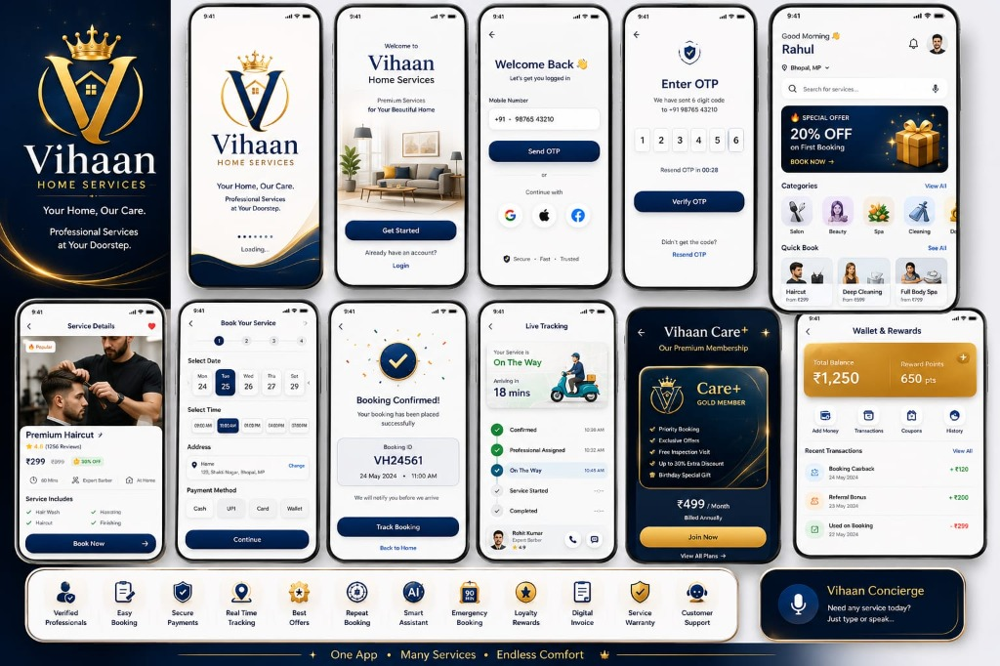

# 👑 Vihaan Home Services - Enterprise Production Application

<div align="center">


### *"Your Home, Our Care. Professional Services at Your Doorstep."*

[](https://vitejs.dev/)
[](https://react.dev/)
[](https://www.typescriptlang.org/)
[](https://tailwindcss.com/)

*Built strictly according to the **Vihaan Home Services Product Requirements & Build Specification (34 Pages)** and official reference UI mockup.*

</div>

---

## 📸 Official UI Showcase & Design System

<div align="center">
  
  <p><em>Complete Production UI Suite: Splash, Onboarding, OTP Verification, Catalog, 8-Step Wizard, Real-time GPS Tracking, Care+ Pass, and Wallet Hub.</em></p>
</div>

---

## 🌟 Overview & Architecture

Vihaan Home Services is an enterprise-grade, luxury home service marketplace and operations suite. It delivers high-touch customer experiences, real-time dispatch operations for service professionals, and a complete command center for platform administrators.

<table align="center" width="100%">
  <tr>
    <td width="30%" align="center" valign="middle">
      
      <br/>
      <strong>Vihaan Official App Emblem</strong>
    </td>
    <td width="70%" valign="top">
      <h3>🎨 Brand Identity & Design System</h3>
      <ul>
        <li><strong>Color Palette:</strong>
          <ul>
            <li>Deep Navy: <code>#061A33</code> (Primary Foundation)</li>
            <li>Royal Blue: <code>#0B3A78</code> (Brand Gradient & Highlights)</li>
            <li>Pure Gold: <code>#D9A928</code> (VIP Accents & Primary Badges)</li>
            <li>Light Accent Gold: <code>#F5D36A</code> (Text Contrast & Glow)</li>
            <li>Soft Neutral Canvas: <code>#F7F8FA</code> (Clean Content Body)</li>
          </ul>
        </li>
        <li><strong>Typography & Aesthetics:</strong> Plus Jakarta Sans & Playfair Display, luxury golden crest branding, glassmorphism cards, micro-interactions, canvas confetti celebrations, and animated status badges.</li>
        <li><strong>Dual Device Experience:</strong>
          <ul>
            <li><strong>iOS 15 Mobile Frame Mode:</strong> Pixel-accurate reproduction with camera notch, 9:41 status bar (WiFi, signal, battery), sticky header, fluid bottom navigation tabs, and gesture overlays.</li>
            <li><strong>Responsive Desktop Mode:</strong> Expansive desktop dashboard tailored for wide displays, high-density analytical dashboards, and management tables.</li>
          </ul>
        </li>
      </ul>
    </td>
  </tr>
</table>

---

## 👥 Multi-Role User Matrix & Instant Demo Access

The platform features an instant **Role Switcher Bar** with pre-configured mock credentials and universal authentication:

| Role | Account Name | Demo Email | Password | OTP (Universal / Service) | Key Capabilities |
| :--- | :--- | :--- | :--- | :--- | :--- |
| **Customer** | Rahul Sharma | `customer@vihaan.demo` | `Demo@123` | `123456` | Splash & Onboarding, 8+ Category Browsing, 8-Step Wizard, GPS Live Tracking, Masked Chat, Vihaan Care+ Pass, Loyalty Wallet, Warranty Claims, Digital PDF Invoices. |
| **Service Pro** | Rohit Kumar | `professional@vihaan.demo` | `Demo@123` | `123456` (Start OTP: `4821` / `1234`) | Real-time Job Dispatch, Online/Offline Toggle, Doorstep Arrival Alert, 4-digit Customer Start OTP verification, Work Proof Photo Upload, Daily ₹2,450 Earnings & Instant Payouts. |
| **Super Admin** | Sanjay Verma | `admin@vihaan.demo` | `Demo@123` | `123456` | ₹1.48 Cr GMV Platform Analytics, Dynamic Catalog CRUD, Partner KYC Document Approvals, Global Booking Status Overrides, Coupon Code Engine, Helpdesk Ticket Resolution. |

> 💡 **Quick Access:** Click the top toolbar's role chips or the **"Demo OTP: 123456"** button to jump into any role instantly without re-typing.

---

## 📱 Comprehensive Feature Directory

### 1. Customer Experience & Discovery
- **9-City Location Switcher:** Instant operational city selector across *Bhopal, Lucknow, Delhi NCR, Noida, Gurgaon, Bengaluru, Mumbai, Pune, and Hyderabad*.
- **Live Search & Voice AI:** Instant search debouncing across services, categories, descriptions, and tags with integrated Web Speech recognition.
- **Service Categories:** Salon for Men & Women, Deep Home Cleaning, Luxury Spa & Wellness, AC & Appliance Repair, Electrical & Plumbing, Pest Control, Express Painting, and Packers & Movers.
- **Promotional Carousels & Package Combos:** Discount banners (`FIRST20`, `HOME150`, `CLEAN100`) and bundle savings (e.g. *Home Cleaning Super Combo* saving ₹700).
- **90-Min Emergency SOS Dispatch:** Urgent doorstep dispatch for plumbing floods, electrical short-circuits, and door lockout emergencies.
- **Favorites & 1-Click "Book Again":** Save preferred services and top-rated professionals for repeat bookings.

### 2. End-to-End 8-Step Booking Wizard
1. **Service & Quantity Selection:** Complete inclusions, exclusions, and warranty information.
2. **Date Selection:** Interactive horizontal calendar date chips.
3. **Time Slot Selector:** Standard slots (09:00 AM, 11:00 AM, 01:00 PM, 04:00 PM, 07:00 PM).
4. **Doorstep Address Picker:** Switch between saved Home/Work addresses or add custom addresses with landmark details.
5. **Professional Matching:** Choose between Vihaan Smart Auto-Match or browse verified individual professionals by rating and portfolio.
6. **Flexible Payment Gateways:** UPI, Credit / Debit Cards, Net Banking, Vihaan Wallet, and Cash on Delivery.
7. **Coupons & Rewards Redemption:** Instant coupon codes (`FIRST20`, `HOME150`, `CLEAN100`) and direct redemption of reward points (2 points = ₹1).
8. **Confirmation Celebration:** Confetti burst, unique booking code (e.g., `#VH24561`), calendar sync prompt, and direct link to live GPS tracking.

### 3. Live Service Tracking & In-App Communication
- **Real-Time GPS Tracking Map:** Interactive simulation tracking the partner's bike moving toward the customer's coordinates with dynamic ETA countdown.
- **5-Stage Status Timeline:** `CONFIRMED` ➔ `PROFESSIONAL_ASSIGNED` ➔ `ON_THE_WAY` ➔ `SERVICE_STARTED` ➔ `COMPLETED`.
- **Encrypted In-App Chat:** Real-time bi-directional messaging between customer and partner with quick reply chips, doorstep photo sharing, and live location pins.
- **Doorstep Security:** Secure 4-digit start OTP shared only when the partner arrives at the doorstep.

### 4. Vihaan Concierge AI Assistant
- Floating voice- and text-enabled AI concierge assistant.
- Multilingual natural language understanding supporting **English**, **Hindi (हिन्दी)**, and **Hinglish**.
- Voice-enabled speech input and synthesized voice readout for queries on bookings, cooling issues, pricing, coupons, and wallet balances.

### 5. Vihaan Care+ Gold VIP Membership
- Luxury Gold VIP membership pass card with embossed crown crest monogram.
- Perks: Priority booking slots (45–60 mins), up to 30% extra member discounts, free quarterly inspections, and zero convenience charges.
- Flexible annual and monthly subscription switching.

### 6. Digital Invoices & 7-Day Guarantee
- **Printable Tax Invoices:** Detailed GST digital invoices with one-click print and PDF download trigger.
- **7-Day Workmanship Warranty:** Free re-inspection claim filing and instant resolution tracking directly from the booking record.
- **Instant Wallet Refunds & Free Rescheduling:** 100% instant refund back to Vihaan Wallet for cancellations up to 2 hours prior to the slot.

### 7. Professional & Super Admin Command Hubs
- **Partner Hub:** Manage incoming requests, view turn-by-turn navigation, trigger doorstep arrival alerts, verify start OTPs, upload completion proof photos, and request instant daily bank payouts.
- **Super Admin Hub:** Monitor platform-wide GMV (₹1.48 Cr), active booking volume, KYC document approval desks (Aadhaar, diploma, bank verification), real-time booking status overrides, and support ticket resolutions.

---

## 🛠️ Technology Stack

| Layer | Technologies |
| :--- | :--- |
| **Core Framework** | React 19, TypeScript, Vite |
| **Styling & Theme** | Tailwind CSS 3.4, PostCSS, Lucide React Icons |
| **Visual Effects** | Canvas Confetti, CSS Keyframe Animations |
| **State Management** | React Context API with Local State Persistence & Simulators |
| **Speech & Audio** | Web Speech API (SpeechRecognition & SpeechSynthesis) |

---

## 📁 Project Directory Structure

```text
vihaan-home/
├── index.html                   # HTML5 Entry Point with Google Fonts & Meta tags
├── package.json                 # Dependencies & Build Scripts
├── postcss.config.js            # PostCSS configuration
├── tailwind.config.js           # Custom Gold/Navy Theme tokens & animations
├── tsconfig.json                # TypeScript compiler configuration
├── vite.config.ts               # Vite bundler configuration
├── public/
│   └── docs/
│       └── images/              # Official Brand & UI Assets
│           ├── vihaan-logo-crest.jpg
│           ├── vihaan-ui-screens-overview.jpg
│           └── vihaan-app-icon.jpg
├── src/
│   ├── main.tsx                 # Application bootstrap
│   ├── App.tsx                  # Master viewport container & modal dispatcher
│   ├── index.css                # Global styles, tailwind directives & scrollbars
│   ├── types/
│   │   └── index.ts             # Domain models (User, Booking, Services, KYC, etc.)
│   ├── context/
│   │   └── AppContext.tsx       # Global state machine, role switching & business logic
│   ├── data/
│   │   └── mockData.ts          # Mock dataset for services, categories, users & bookings
│   └── components/
│       ├── common/              # Common UI Elements
│       │   ├── Header.tsx               # Sticky header with location & wallet pill
│       │   ├── BottomNav.tsx            # iOS bottom navigation bar
│       │   ├── RoleSwitcherBar.tsx      # Top developer/demo role switch toolbar
│       │   ├── VihaanLogo.tsx           # Scalable SVG Crown monogram & wordmark
│       │   ├── DemoCredentialsModal.tsx # Quick-copy demo credentials dialog
│       │   └── ToastContainer.tsx       # Floating alert toasts
│       ├── customer/            # Customer Portal Views & Modals
│       │   ├── HomeScreen.tsx           # Category grid, promos, SOS cards, combos
│       │   ├── CategoryView.tsx         # Filterable catalog by category
│       │   ├── ServiceDetailModal.tsx   # Detailed specs, gallery & inclusions
│       │   ├── BookingFlowModal.tsx     # 8-Step multi-step booking wizard
│       │   ├── BookingConfirmationModal.tsx # Confirmation celebration
│       │   ├── LiveTrackingModal.tsx    # Live GPS tracking map & partner info
│       │   ├── ChatModal.tsx            # Masked customer-partner chat
│       │   ├── BookingHistoryScreen.tsx # History tabs (Ongoing, Completed, Cancelled)
│       │   ├── ConciergeAIFloating.tsx  # Floating voice & multilingual AI assistant
│       │   ├── VihaanCareModal.tsx      # Care+ Gold membership modal
│       │   ├── WalletModal.tsx          # Dual balance wallet & transactions
│       │   ├── EmergencyBookingModal.tsx# 90-min SOS instant booking
│       │   ├── DigitalInvoiceModal.tsx  # Printable tax invoice
│       │   ├── WarrantyModal.tsx        # 7-day warranty claim filing
│       │   ├── ReviewModal.tsx          # Multi-criteria rating & photo feedback
│       │   ├── ReferralModal.tsx        # Refer & Earn ₹200 modal
│       │   ├── SupportCenterModal.tsx   # Help tickets & FAQs
│       │   ├── RescheduleModal.tsx      # Slot rescheduling
│       │   ├── CancelModal.tsx          # Cancellation with instant wallet refund
│       │   ├── ProfileScreen.tsx        # Customer profile management
│       │   ├── SplashScreen.tsx         # Brand splash screen
│       │   ├── OnboardingScreen.tsx     # Introductory onboarding slider
│       │   └── NotificationsModal.tsx   # Activity notifications center
│       ├── professional/        # Service Professional Hub
│       │   └── ProfessionalDashboard.tsx # Dispatch jobs, OTP, proof & earnings
│       └── admin/               # Super Admin Command Center
│           └── AdminDashboard.tsx       # Analytics, Catalog CRUD, KYC, Bookings, Tickets
```

---

## 🚀 Getting Started Locally

### Prerequisites
- Node.js (v18.0.0 or higher recommended)
- npm or yarn

### Installation & Run

```bash
# 1. Clone repository or navigate to project directory
cd vihaan-home

# 2. Install dependencies
npm install

# 3. Start development server
npm run dev
```

Visit `http://localhost:5173` in your browser.

### Building for Production

```bash
# Build production bundle
npm run build

# Preview production build locally
npm run preview
```

---

## 💡 Quick Tips for Reviewers

1. **Switching Roles:** Use the top bar at any time to switch seamlessly between **Customer (Rahul)**, **Partner Pro (Rohit)**, and **Super Admin (Sanjay)**.
2. **Switching Viewports:** Toggle between the mobile phone icon (iOS 15 frame) and the monitor icon (desktop view) in the top toolbar.
3. **Testing Booking Lifecycle:**
   - As a **Customer**, book any service (e.g. *Premium Haircut*).
   - Enter booking details, select a date/slot, apply coupon `FIRST20`, and complete booking.
   - Click **Track Booking** to view the live GPS route map and note the 4-digit start OTP (`4821` or `1234`).
   - Switch role to **Partner Pro** in the top bar to accept the job, click **Arrived at Doorstep**, verify the start OTP, and complete the service with photo proof.
   - Switch back to **Customer** to rate the service, view the digital tax invoice, or file a 7-day warranty claim.
4. **Testing Voice AI Concierge:** Click the bottom-right floating gold bot badge to open the Concierge AI. Type or click quick prompts (or speak using your microphone) to ask about haircut booking, emergency plumbers, or coupons in English, Hindi, or Hinglish.

---

## 📄 License
This project is proprietary and built for Vihaan Home Services. All rights reserved.
